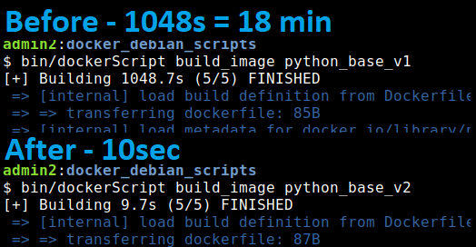

# Docker Debian Scripts


- Project of docker automation scripts
- Creates dockerFile images in the `images` folder
- `images/baseimage` - template for all images
- `bin/dockerScript run_image %IMAGE%` runs the image with the project folder mounted as `/home/project`

## BIN

- .env
    - variables for scripts
- dockerScript

## dockerScript

- bin/dockerScript

```
HELP
:
echo "bin/dockerScript create_dockerImage %IMAGE%"
echo "bin/dockerScript build_image %IMAGE% [-force]"
echo "bin/dockerScript run_image %IMAGE%"
echo "bin/dockerScript shell %IMAGE%"
echo "bin/dockerScript shell_as_root %IMAGE%"
```

## Images

- golang_imagev1
    - debian 12, installed: golang, ginkgo
- clang_imagev1
    - debian 12, installed: g++, libcriterion-dev
- clang_golang_v1
    - debian 12
        - installed: golang, ginkgo
        - installed: g++, libcriterion-dev

## How to set fast Docker registry mirrors

- For debian distros (Debian, Ubuntu, Mint)
- Create or append to /etc/docker/daemon.json
```shell
cat << EOF | sudo tee -a /etc/docker/daemon.json
{ "registry-mirrors" : [ "https://dockerhub.timeweb.cloud", "https://huecker.io", "https://mirror.gcr.io", "https://c.163.com", "https://registry.docker-cn.com", "https://daocloud.io" ] }
EOF
```
- Verify /etc/docker/daemon.json
    - ```cat /etc/docker/daemon.json```
- Restart docker service
    - ```systemctl restart docker```
- Verify docker service config
    - ```systemctl restart docker```

See full script:
```shell 
cat << EOF | sudo tee -a /etc/docker/daemon.json
{ "registry-mirrors" : [ "https://dockerhub.timeweb.cloud", "https://huecker.io", "https://mirror.gcr.io", "https://c.163.com", "https://registry.docker-cn.com", "https://daocloud.io" ] }
EOF
cat /etc/docker/daemon.json
systemctl restart docker
docker info | grep -A 4 "Registry Mirrors"
```



## License
- [MIT](LICENSE.md)